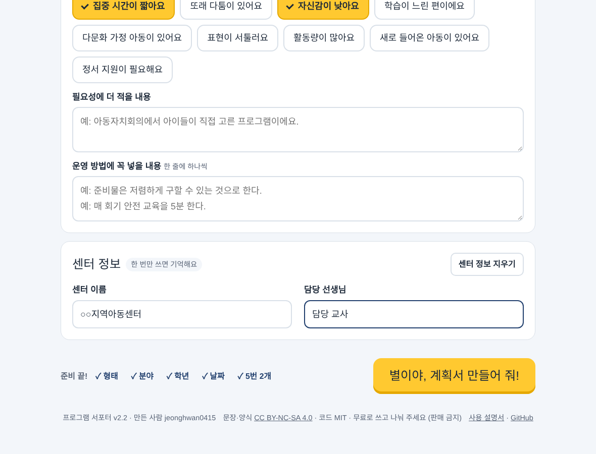
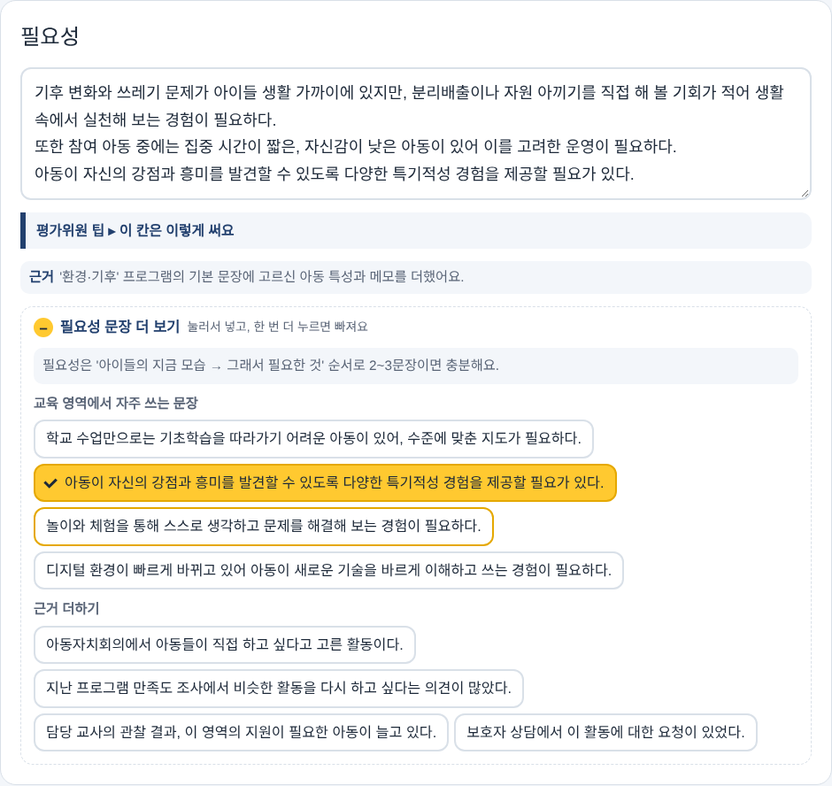
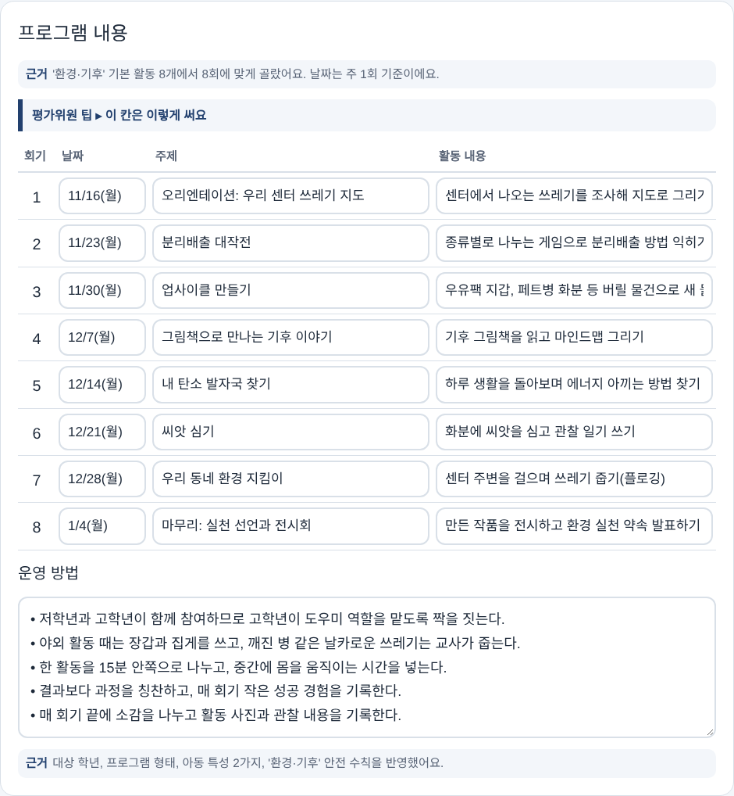
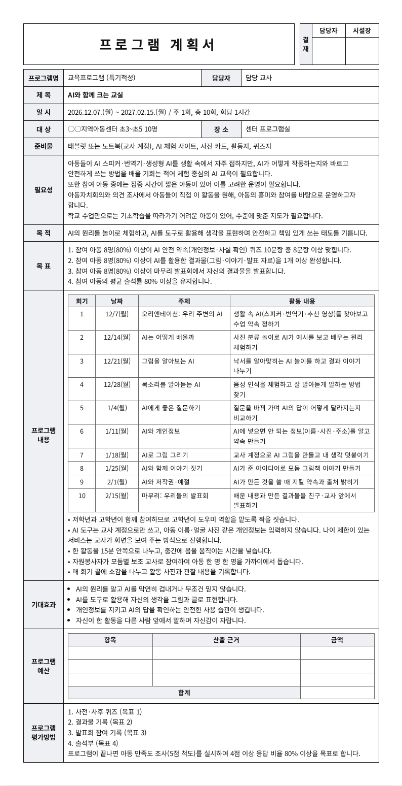
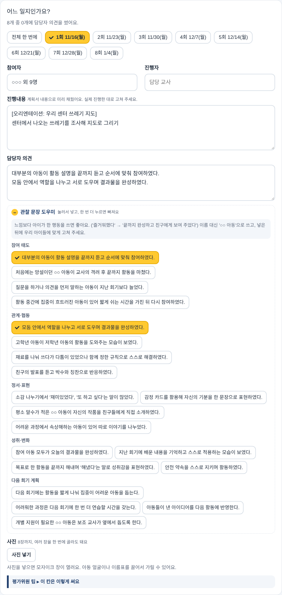
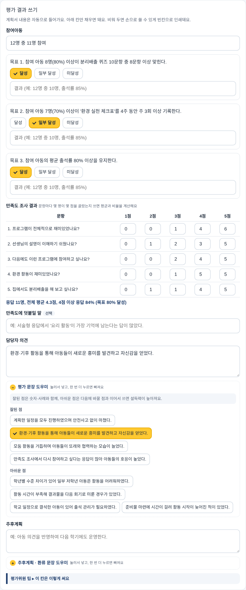
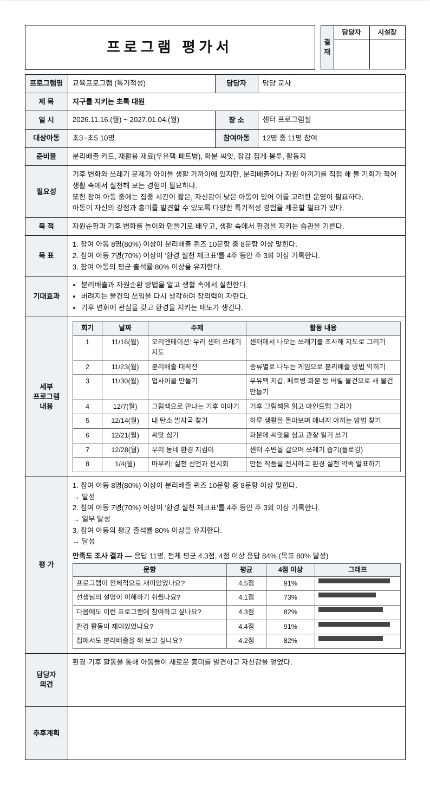

# 06 와이어프레임

과제명: 지역아동센터 프로그램 서포터 · 기준: v2.2 (2026-11-14)

> 시안이 아니라 **실제로 만든 화면 캡처**입니다. 예시 데이터(환경·기후, 초3~초5, 10명, ○○지역아동센터)만 넣었고 실제 아동 정보는 없습니다. 이미지는 `images/06_wireframe/`에 번호로 저장합니다. 다른 서비스 화면은 저작권 때문에 글로만 적었습니다([02 벤치마킹](02_benchmarking.md)).

## 형태 고르기

| 후보 | 설명 | 선택 |
| :---- | :---- | :---- |
| 웹 1. 심플 검색형 | 검색창 하나에 결과 목록. 쉽지만 칸이 많은 서류에는 맞지 않음 | |
| 웹 2. 대시보드형 | 숫자와 차트를 한눈에. 서류 작성보다 현황 보기에 맞음 | |
| 웹 3. 단계 진행형 | 고르기 → 확인 → 출력을 단계별로. PRD의 업무 흐름과 같음 | **선택** |
| 로컬 프로그램 | 설치가 필요해서 40~50대 선생님께 나눠 드리기 어려움 | |

선택 이유: 한 화면에서 한 가지만 하게 하고, 다음 할 일을 캐릭터 '별이'가 말풍선으로 알려 준다. 파일 하나를 더블클릭하면 열리고, 휴대폰은 GitHub Pages 주소로 본다.

## 이미지 목록

| 번호 | 위치 | 한 줄 설명 |
| :---- | :---- | :---- |
| 01 | 1단계 위 | 머리말·단계 표시·별이, ① 형태 ② 분야 |
| 02 | 1단계 ② 분야 | 5대 영역 23개 키워드, **'새'** 5개 |
| 03 | 1단계 아래 | 센터 정보, **준비 상태**, 만들기 버튼, 저작권 표시 |
| 04 | 2단계 위 | **서류 만들기 전 점검**, 기본 정보 |
| 05 | 2단계 필요성 | **필요성 문장 도우미** (영역별 + 근거 더하기) |
| 06 | 2단계 목표 | 숫자 목표 3개 + 근거 |
| 07 | 2단계 프로그램 내용 | 회기표 + 운영 방법 |
| 08 | 3단계 위 | 서류 탭, 결재란 |
| 09 | 계획서 종이 | A4 계획서 |
| 10 | 3단계 일지 | 회기 고르기, **작성 현황**, **관찰 문장 도우미** |
| 11 | 일지 종이 | A4 일지 |
| 12 | 3단계 평가서 | 목표 달성, 만족도 응답 수, **평가 문장 도우미** |
| 13 | 평가서 종이 | A4 평가서 + 만족도 막대그래프 |
| 14 | 만족도 조사지 | 얼굴 그림 5점 척도 |
| 15·16 | 휴대폰 | 1단계, 2단계 점검 |
| 17 | 2단계 평가 지표 | **평가 지표 맞추기** (v2.2) |
| 18 | 2단계 필요성 | **평가위원 팁** (v2.2) |
| 19·20 | 3단계 가정통신문 | **가정통신문(선택)** 입력과 A4 (v2.2) |

## 흐름

```
[1. 내용 고르기] ─→ [2. 계획서 확인] ─→ [3. 서류 만들기]
 형태·분야·대상·일정·특성   점검·칸마다 고치기·근거·예산   계획서 / 일지 / 평가서 → 인쇄·PDF·워드
```

계획(계획서) → 실행(회기마다 일지) → 평가(끝나면 평가서)가 같은 내용으로 이어집니다.

### 1. 내용 고르기


**화면 설명**
* 머리말: 캐릭터, 이름, AI 설정 버튼(선택 기능)
* 단계 표시: 지금 단계는 노란색, 끝난 단계는 초록 숫자
* 별이 말풍선: 무언가 고를 때마다 바뀜. 빠진 칸이 있으면 빨간 테두리
* ① 형태: 정기 / 하루 행사 / 숙박 캠프 → ④ 일정 칸이 형태에 맞게 바뀜


**화면 설명**
* 영역별 키워드 23개. v2.1에서 더한 5개에 **'새'** 표시
* 나들이·체험, 행사·축제는 '하루 행사'로 자동 전환
* 목록에 없으면 직접 쓰기 (기본 틀로 만들어짐)



**화면 설명**
* ⑤ 아동 특성 9개, 필요성 메모, 운영 방법 요청 → 계획서 문장에 들어감
* 센터 정보는 한 번만 쓰면 기억
* **준비 상태 (v2.1)**: 형태·분야·학년·날짜 중 빠진 것은 노란색, 다 고르면 '준비 끝!'
* 맨 아래 만든 사람·이용 조건

**시사점:** 40~50대 선생님은 "무엇을 안 골랐는지"를 버튼을 누른 뒤에야 알았음 → 누르기 전에 보이게 함

### 2. 계획서 확인


**화면 설명**
* **서류 만들기 전 점검 (v2.1)**: 확인할 곳만 크게, 통과한 항목은 한 줄 배지. [고치러 가기]를 누르면 그 칸으로 이동하고 커서가 들어감
* 기본 정보: 영역 대분류·중분류, 제목([다른 제목 추천]), 대상, 장소, 일시, 회기, 준비물
* AI 키가 있을 때만 [AI로 문장 다듬기]



**화면 설명**
* 필요성 칸 아래 **[필요성 문장 더 보기]**: 지금 영역(교육)에서 자주 쓰는 문장 + 근거 더하기(아동자치회의, 만족도 조사, 보호자 상담…)
* 누르면 새 줄로 들어가고 노란색, 다시 누르면 그 문장만 빠짐. 상자는 열린 채로 있음
* 목적은 '다른 목적 문장 고르기'(바꾸기), 기대효과도 같은 상자


**화면 설명**
* 목표 3개(키워드 2 + 형태별 공통 1)와 평가 방법, 목표마다 **근거**(예: 10명 × 80% = 8명)



**화면 설명**
* 회기표(정기) 또는 시간표(하루·캠프), 운영 방법(학년 → 형태 → 키워드 안전 문장 → 아동 특성 → 요청 → 기록 순)

### 2-1. 평가 지표 맞추기와 평가위원 팁 (v2.2)


**화면 설명**
* 평가 지표(2-1 문화 / 2-2 교육 / 2-3 특화)를 형태·영역으로 자동 추천, 고르면 필수조건 안내
* 사업계획서 반영, ③ 의견 수렴(누구에게 + 한 줄), ⑤ 아동의 참여, ⑦ 지역사회와 공유 → 빠지면 점검 목록에 `[평가 …]`
* 고른 내용은 계획서 필요성 아래 '※ 의견 수렴', 평가방법·평가서 평가 칸에 문장으로 들어감


**화면 설명**
* 칸마다 접힌 '이 칸은 이렇게 써요': 평가 항목 번호와 쓰는 요령, 센터장 경험 한 줄

**시사점:** 평가 기준을 따로 찾아보지 않아도 계획 단계에서 증빙(의견 수렴·아동 평가회·공유)을 챙기게 함

### 3. 서류 만들기


**화면 설명**
* 탭: 계획서(시작 전) · 일지(회기마다) · 평가서(끝나면)
* 결재란: 담당자·시설장 / 담당·센터장 / 담당자·사무국장·시설장 + 직접 고치기('담당/팀장/센터장')

<details>
<summary>계획서 종이 (A4)</summary>



</details>



**화면 설명**
* 회기 버튼에 의견을 쓴 회기는 **'· 작성'**, 위에 'n개 중 m개' (v2.1)
* 참여자, 진행자, 진행내용(계획서에서 미리 채움), 담당자 의견, 사진 8장(넣으면 모자이크 창)
* **관찰 문장 도우미 (v2.1)**: 참여 태도 · 관계·협동 · 정서·표현 · 성취·변화 · 다음 회기 계획. 위에 "느낌보다 행동", "○○ 아동" 작성 요령

<details>
<summary>일지 종이 (A4)</summary>


</details>



**화면 설명**
* 참여아동, 목표마다 달성/일부 달성/미달성 + 결과
* 만족도 응답 수 표 → 평균·4점 이상 비율 자동
* **평가 문장 도우미**(잘된 점·아쉬운 점), **추후계획 문장 도우미** (v2.1)

<details>
<summary>평가서 종이 (A4), 만족도 조사지</summary>




</details>

### 가정통신문 (선택, v2.2)


**화면 설명**
* 보내는 날·마감일·참가비·문의 연락처·집결·해산·아이 준비물·더 알릴 내용만 입력
* '참가 회신서 붙이기', '사진 게시 동의 칸 넣기' 켜고 끄기, 이 서류 팁(3-4 보호자 참여 지원 근거)

<details>
<summary>가정통신문 종이 (A4)</summary>


</details>

### 휴대폰

| 1단계 | 2단계 점검 |
| :---: | :---: |
|  |  |

* 화면 폭이 좁으면 버튼이 한 줄씩, A4 미리보기는 폭에 맞게 줄어듦. 인쇄할 서류는 PC에서 작성 권장

## 시사점 정리

* 빈칸 앞에서 막히는 곳(필요성 2번째 문장, 일지 의견, 평가 의견, 추후계획)에 **고를 수 있는 문장**을 두되, 선생님 문장을 지우지 않게 넣기·빼기만
* 빠진 칸은 **막지 않고 알려만** 줌 (손으로 쓰는 센터도 있음)
* 새 기능은 모두 기존 칸 바로 아래에 접힌 상자로 → 화면이 복잡해지지 않게
