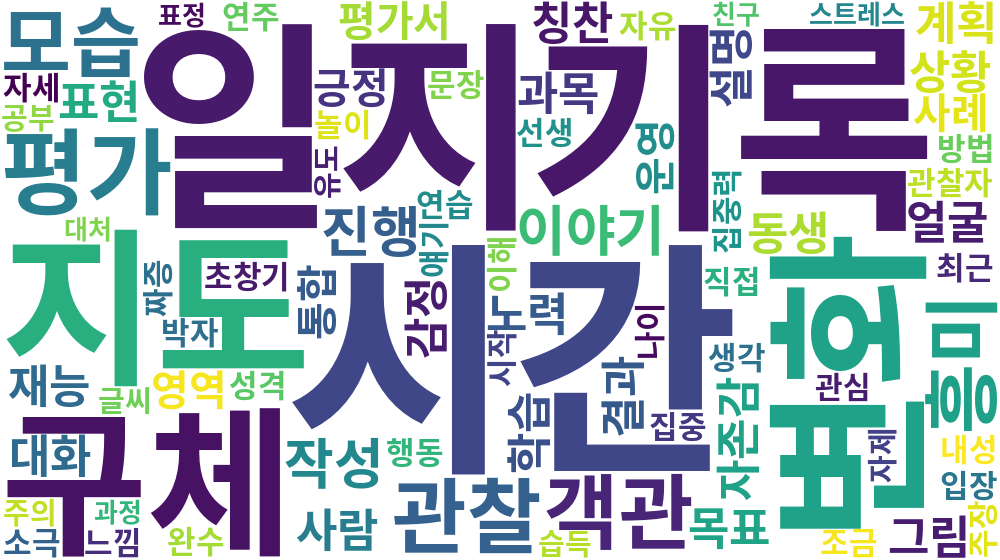
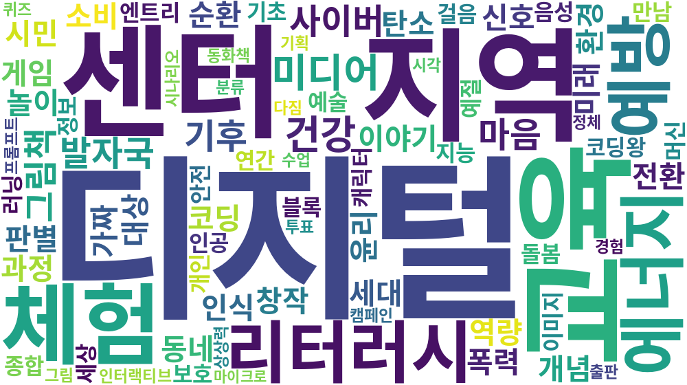

# **08 어휘 보강 (크롤링 · 워드클라우드)**

**개인 프로젝트**
과제명: 지역아동센터 프로그램 서포터 · 기준: v2.2 (2026-11-14)
계획서·일지·평가서 문장이 키워드마다 한 벌뿐이라 비슷해 보이는 문제를 풀려고, 공개 자료에서 **현장이 실제로 쓰는 낱말**을 모아 새 키워드와 문장 도우미를 만들었습니다.

## 1. 한눈에 보기

| 단계 | 한 일 | 도구 |
| :---- | :---- | :---- |
| ① 모으기 | 공개 자료 7종 검색·수집 (계획서 3, 일지·평가서 2, 트렌드 2) | Firecrawl 검색·스크래핑 (Claude Cowork) |
| ② 세기 | 명사·동사 빈도, 자료 묶음별 상위 낱말, **기존 프로그램에 없던 낱말** | Kiwi 형태소 분석기 — `tools/analyze_vocabulary.py` |
| ③ 보기 | 워드클라우드 4장 | wordcloud + Noto Sans CJK |
| ④ 새로 쓰기 | 낱말만 참고해 쉬운 말로 새 문장 80개, 새 키워드 5개 | 사람이 검토 (07 프롬프트 ⑥) |

**원칙:** 원문 문장은 옮기지 않았어요. 낱말 빈도만 참고했고, 수집한 발췌문은 저장소에 올리지 않아요(`data/vocabulary/corpus/`는 .gitignore).
썸트렌드는 로그인·유료라 쓰지 못했고, 대신 Firecrawl Trends(구글 트렌드)로 연관 검색어를 찾았지만 한국 데이터가 0건이었어요.

## 2. 워드클라우드


| 계획서 자료 | 일지·평가서 자료 | 트렌드 자료 |
| :---: | :---: | :---: |
|  |  |  |

## 3. 많이 나온 낱말

| 묶음 | 상위 낱말 (빈도) |
| :---- | :---- |
| 계획서 | 사회(20) · 교육(17) · 문화(16) · 놀이(15) · 다양(14) · 환경(13) · 이해(12) · 향상(12) · 정서(12) · 학습(11) · 지도(10) · 체험(9) · 지역(9) · 제공(9) · 안전(9) · 연계(8) · 필요(7) · 생활(7) · 능력(7) · 특성(7) |
| 일지·평가서 | 시간(5) · 일지(4) · 기록(4) · 지도(4) · 변화(4) · 구체(4) · 평가(4) · 관찰(3) · 객관(3) · 모습(3) · 흥미(3) · 이야기(3) · 작성(3) · 진행(3) · 얼굴(2) · 동생(2) · 표현(2) · 사람(2) · 상황(2) · 그림(2) |
| 트렌드 | 디지털(13) · 지역(5) · 센터(5) · 교육(5) · 체험(4) · 리터러시(4) · 예방(4) · 에너지(4) · 미디어(4) · 건강(4) · 사이버(3) · 발자국(3) · 그림책(3) · 기후(3) · 마음(3) · 코딩(2) · 놀이(2) · 창작(2) · 시민(2) · 게임(2) |
| 일지·평가서 동사 | 보이다(10) · 좋아하다(5) · 대하다(3) · 친하다(2) · 지내다(2) · 그리다(2) · 높이다(2) · 느끼다(2) · 숙이다(1) · 엎드리다(1) · 취하다(1) · 가지다(1) |

**기존 프로그램에 없던 낱말 (전체):** 제공(9) · 가치(6) · 발달(6) · 도모(6) · 개별(6) · 긍정(6) · 자원(6) · 모습(5) · 개념(5) · 변화(5) · 건전(5) · 설계(5) · 세계(4) · 인천(4) · 상호(4) · 자아(4) · 안정감(4) · 형성(4) · 적응(4) · 예술(4) · 리터러시(4) · 에너지(4) · 미디어(4) · 마을(3) · 함양(3) · 서비스(3) · 심리(3) · 사례(3) · 네트워크(3) · 맞춤(3) · 인식(3) · 파악(3) · 동기(3) · 재능(3) · 역량(3) · 객관(3) · 사이버(3) · 발자국(3) · 기후(3) · 위로(2)

## 4. 어디에 반영했나

| 발견 | 반영 |
| :---- | :---- |
| 계획서 자료에 '사회성·정서·강점·자아·안정감·공동체·적응'이 많음 | 필요성·목적·기대효과 문장 도우미를 **5대 영역별**로 (`NEED_MORE`·`PURPOSE_MORE`·`EFFECT_MORE`) |
| '도모·함양·고취·배양' 같은 한자어가 많음 | 쉬운 말로 풀어 씀 ("도모한다" → "돕는다", "함양" → "기른다") |
| 일지 자료: '보이다·모습·변화·흥미·관찰·객관' + "느낌 말고 행동을 쓰라" | 관찰 문장 20개를 **보인 행동**으로, 묶음 5개(참여 태도·관계·정서·성취·다음 계획) (`LOG_PHRASES`) |
| 평가 자료: "데이터와 사례로, 아동의 변화를" | 평가 의견 '잘된 점·아쉬운 점', 추후계획 (`EVAL_PHRASES`·`NEXT_PHRASES`) |
| 트렌드: '디지털·리터러시·미디어·기후·에너지·탄소·사이버·가짜·판별' | 새 키워드 **미디어·AI 리터러시**, **환경·기후** |
| 계획서: '세계·문화·다문화·차이' / '자치·권리·참여' / 트렌드 '용돈·소비' | 새 키워드 **세계문화·다문화**, **아동권리·자치**, **경제·용돈** |
| 근거 문장: 아동자치회의, 만족도 조사, 보호자 상담 | 필요성 '근거 더하기' 4문장 |

## 5. 수집 자료

자세한 목록: [../data/vocabulary/수집자료_목록.md](../data/vocabulary/수집자료_목록.md) · 숫자 원본: [../data/vocabulary/빈도분석.json](../data/vocabulary/빈도분석.json)

## 6. 다시 돌리는 법 (담당자용)

```
pip install kiwipiepy wordcloud
# data/vocabulary/corpus/ 에 plan.txt · log_eval.txt · trend.txt (수집 발췌문) 를 넣고
python tools/analyze_vocabulary.py data/vocabulary/corpus index.html data/vocabulary/out
```

- 썸트렌드 연관어 엑셀을 받으면 낱말 열을 `trend.txt`에 붙여 넣고 다시 돌리면 돼요.
- Windows 글꼴은 `FONT = "C:/Windows/Fonts/malgunbd.ttf"`로 바꿔요.
